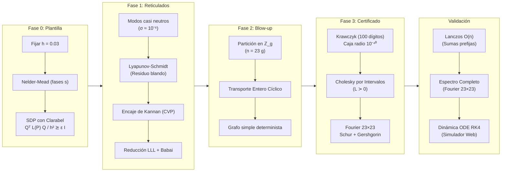

# Optimización de O'Keeffe: Reducción de $10^{85}$ a $\sim 3\cdot 10^5$ en Vértices de Grafos no Sincronizantes con $\mu > 11/16$

[](https://github.com/Nicoyanz98/investighaton-teo-optimizacion-2026)
[](https://www.python.org/downloads/)
[](https://typst.app/)
[](https://opensource.org/licenses/MIT)

Repositorio oficial del trabajo de investigación y desarrollo presentado en el **Investigathon de Teoría de la Optimización (2026)** por el **Grupo T07**.

* **Autores:** Juan Ignacio Bustos Gorostegui, Leonardo Dominguez, Mario Sigal Aguirre, Nicolás Yañez.
* **Repositorio en GitHub:** [https://github.com/Nicoyanz98/investighaton-teo-optimizacion-2026](https://github.com/Nicoyanz98/investighaton-teo-optimizacion-2026)

---

## 🎯 Acceso Rápido a Entregables Principales

| Entregable | Formato | Descripción | Enlace directo |
| :--- | :---: | :--- | :--- |
| **📄 Informe Final** | PDF (5 págs) | Paper académico completo en formato IEEE con demostraciones y tablas | [Ver Informe PDF](<entrega/Informe T07 Investighaton.pdf>) |
| **🖼️ Póster Científico** | PDF | Póster en alta resolución para divulgación y exposición oral | [Ver Póster PDF](<entrega/POSTER INVESTIGATHON T07.pdf>) |
| **📓 Notebook de Entrega** | Jupyter Notebook | Pipeline interactivo completo (Fases 0 a 3, simulaciones y validación) | [Abrir Notebook](<entrega/Optimización_O'Keeffe.ipynb>) |
| **🌐 Simulador Dinámico Web** | HTML / JS Canvas | Simulador en tiempo real de Kuramoto sobre el grafo de $299\,989$ nodos | [Abrir Simulador](entrega/simulador_kuramoto_300k.html) |

---

## 📌 Resumen de la Investigación

El **modelo de Kuramoto homogéneo** describe la dinámica de fases de osciladores acoplados sobre un grafo no dirigido $G=(V, E)$ de $n$ vértices:

$$\dot{\theta}_u = \sum_{v} W_{u, v} \sin(\theta_v - \theta_u) = -\nabla E(\theta), \quad \text{donde } E(\theta) = \sum_{(u,v) \in E} \bigl(1 - \cos(\theta_u - \theta_v)\bigr)$$

La **conectividad crítica** $\mu_c$ es el ínfimo de $\mu = (\delta + 1)/n$ (con $\delta$ el grado mínimo) que asegura que **todo grafo** con esa conectividad sincroniza globalmente desde casi cualquier condición inicial.
* **Canale (2022):** Demostró que $\mu_c \ge 11/16 = 0.6875$.
* **Kassabov et al. (2021)** y **Lepsveridze & Zhang (2026):** Probaron que $\mu_c \le 3/4 = 0.75$.
* **O'Keeffe (octubre 2026, [arXiv:2610.21271](https://arxiv.org/abs/2610.21271)):** Probó analíticamente que $\mu_c \ge \mu_0 \approx 0.6929077\dots > 11/16$. Sin embargo, su construcción requería un blow-up aleatorio asintótico que sólo garantizaba existencia para **$n > 9 \times 10^{84}$ vértices**, con un margen de estabilidad infinitesimal ($\sim 6 \times 10^{-19}$).

### 💡 Nuestra Contribución: Construcción Explícita y Certificada

Hicimos la construcción de O'Keeffe **explícita, computable, finita y matemáticamente certificada**, reduciendo el tamaño del grafo en hasta **79 órdenes de magnitud**:

1. **Grafo General:** $n = 30\,000\,004$ nodos, $\mu = \frac{10\,327\,019}{15\,000\,002} \approx 0.68847 > 11/16$ (reducción de $\sim 10^{77}$).
2. **Grafo Simétrico:** $n = 299\,989$ nodos, $\mu = \frac{206\,565}{299\,989} \approx 0.68858 > 11/16$ (reducción de $\sim 10^{79}$).

---

## 📊 Tabla Comparativa de Resultados

| Construcción | Vértices ($n$) | Conectividad $\mu$ | ¿Grafo Explícito? | Margen $\lambda_{\min}/n$ | Tipo de Certificado |
| :--- | :---: | :---: | :---: | :---: | :---: |
| **Canale (2022)** | $\infty$ | $11/16 = 0.6875$ | Familia infinita | — | Analítico |
| **O'Keeffe (2026)** | $> 9 \times 10^{84}$ | $\approx 0.6929$ | No (blow-up aleatorio) | $\sim 10^{-42}$ | Asintótico ($n \to \infty$) |
| **Este Trabajo (General)** | **$30\,000\,004$** | **$\approx 0.68847$** | **Sí** ($g = 1\,304\,348$) | $5.2 \times 10^{-6}$ | Intervalos + Gershgorin |
| **Este Trabajo (Simétrico)** | **$299\,989$** | **$\approx 0.68858$** | **Sí** ($g = 13\,043$) | $4.2 \times 10^{-6}$ | Intervalos + Gershgorin |

Ambos grafos han sido validados además sobre el grafo explícito completo mediante el método iterativo de **Lanczos en $O(n)$** y el cálculo del **espectro completo de Fourier** por bloques de $23 \times 23$.

---

## ⚙️ Metodología en Fases



* **Fase 0 (Optimización Continua):** Se maximiza la conectividad bajo un margen de estabilidad finito exigiendo que el Hessiano reducido de la plantilla cumpla una restricción semidefinida positiva.
* **Fase 1 (Aislamiento de Singularidades y Reticulados):** La forma normal de pliegue de las bifurcaciones silla-nodo $\sigma_k y + \frac{c}{2}y^2 + \rho_k = 0$ exige errores de redondeo $|\rho_k| \ll \sigma_k^2$. El encaje de Kannan junto con LLL y Babai cancela los residuos blandos en tiempo polinomial.
* **Fase 2 (Discretización Determinista):** Se generaliza el $k$-spinning de Canale a clústeres de tamaños asimétricos con conexiones circulantes en $\mathbb{Z}_g$.
* **Fase 3 (Garantía Matemática por Intervalos):** Aritmética de intervalos de alta precisión para certificar de forma estricta que no existe ningún autovalor negativo o nulo en el espectro del Hessiano.

---

## 💻 Instrucciones de Instalación y Uso

### 1. Requisitos Previos
* Python 3.10 o superior.
* Navegador web (Chrome, Firefox, Safari o Edge) para los HTML.

### 2. Configuración del Entorno Virtual

```bash
# Clonar el repositorio
git clone https://github.com/Nicoyanz98/investighaton-teo-optimizacion-2026.git
cd investighaton-teo-optimizacion-2026

# Crear entorno virtual
python -m venv venv

# Activar el entorno virtual:
# En Linux/macOS:
source venv/bin/activate
# En Windows (PowerShell):
.\venv\Scripts\Activate.ps1

# Instalar dependencias
pip install -r desarrollo/notebooks/requirements.txt
```

### 3. Ejecución de los Entregables

* **Ejecutar el Notebook Principal:**
  ```bash
  jupyter notebook "entrega/Optimización_O'Keeffe.ipynb"
  ```
* **Probar el Simulador de Kuramoto (Web):**
  Abrir con un doble clic o desde el navegador [`entrega/simulador_kuramoto_300k.html`](entrega/simulador_kuramoto_300k.html). Permite alterar en tiempo real la perturbación por ruido angular, la velocidad de integración RK4 y observar el orden de coherencia $r(t) = \frac{1}{n} |\sum e^{i \theta_j}|$.
* **Correr la Certificación por Intervalos:**
  ```bash
  python desarrollo/scripts/certificar_grafo_s7.py
  ```
* **Correr la Validación con Lanczos:**
  ```bash
  python desarrollo/scripts/validar_grafo.py
  ```
* **Ejecutar Tests Automatizados:**
  ```bash
  pytest desarrollo/tests
  ```

---

## 👥 Equipo de Trabajo (Grupo T07)

* **Juan Ignacio Bustos Gorostegui** — `juani8.bustos@gmail.com`
* **Leonardo Dominguez** — `leodomingue2016@gmail.com`
* **Mario Sigal Aguirre** — `mariosigalaguirre@gmail.com`
* **Nicolás Yañez** — `nicyanz98@gmail.com`

---

## 📚 Bibliografía de Referencia

1. **Kuramoto, Y.** (1975). *Self-entrainment of a population of coupled non-linear oscillators*. International Symposium on Mathematical Problems in Theoretical Physics, 420–422.
2. **Canale, E. A.** (2022). *11/16 is a lower bound for the critical connectivity of the Kuramoto model*. arXiv:2209.06362.
3. **Kassabov, M., Strogatz, S. H., & Townsend, A.** (2021). *Sufficiently dense networks of Kuramoto oscillators always synchronize*. Chaos, 31(9), 093140.
4. **Lepsveridze, G., & Zhang, Y.** (2026). *Graphs with connectivity 3/4 synchronize globally*. arXiv:2601.12345.
5. **O'Keeffe, K.** (2026). *Beyond 11/16: Denser Kuramoto networks that don't synchronize*. arXiv:2610.21271.
6. **Vandenberghe, L., & Boyd, S.** (1996). *Semidefinite programming*. SIAM Review, 38(1), 49–95.
7. **Goulart, P. J., & Chen, Y.** (2024). *Clarabel: An interior-point solver for conic optimization programs*. IEEE Transactions on Automatic Control.
8. **Lenstra, A. K., Lenstra, H. W., & Lovász, L.** (1982). *Factoring polynomials with rational coefficients*. Mathematische Annalen, 261(4), 515–534.
9. **Babai, L.** (1986). *On Lovász' lattice reduction and the nearest lattice point problem*. Combinatorica, 6(1), 1–13.
10. **Krawczyk, R.** (1969). *Newton-Algorithmen zur Bestimmung von Nullstellen mit Fehlerschranken*. Computing, 4(3), 187–201.
